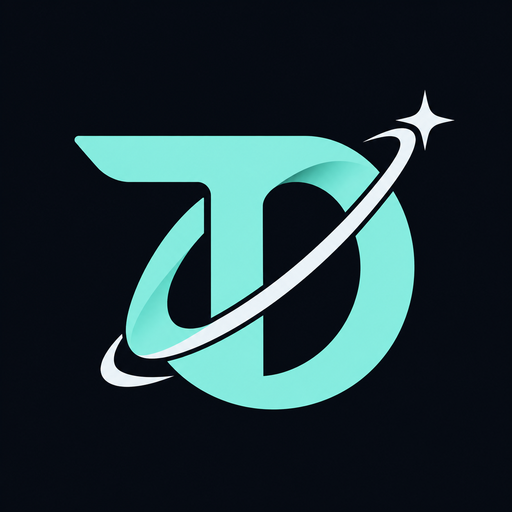
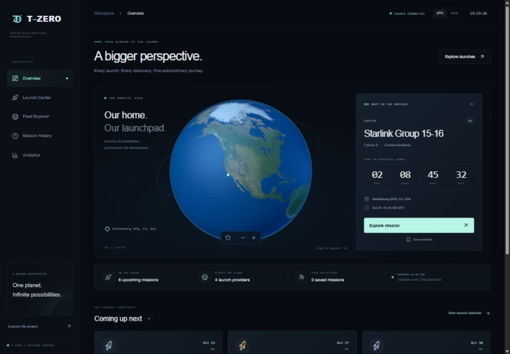
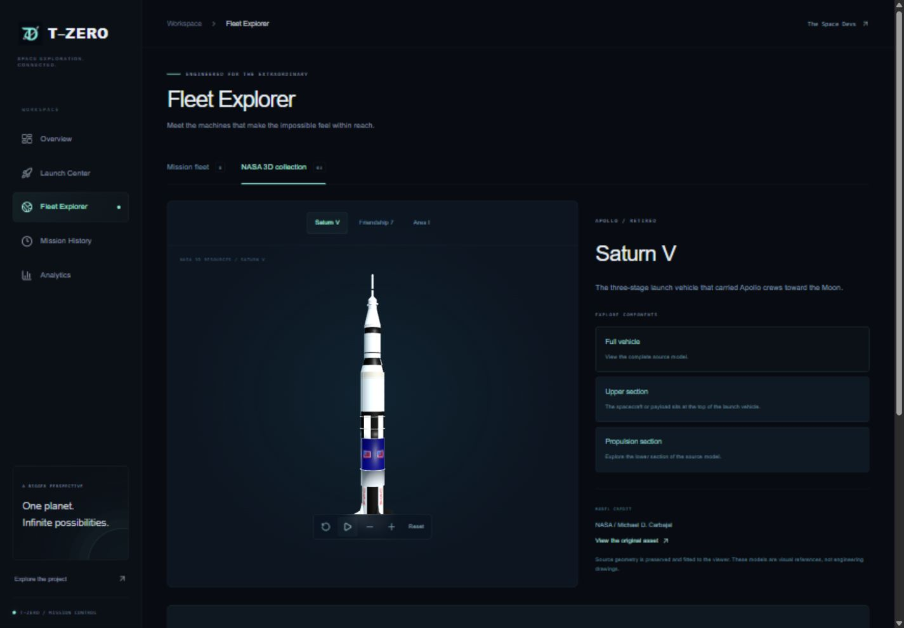
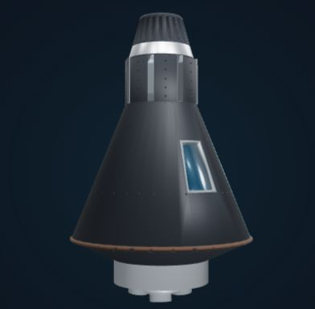
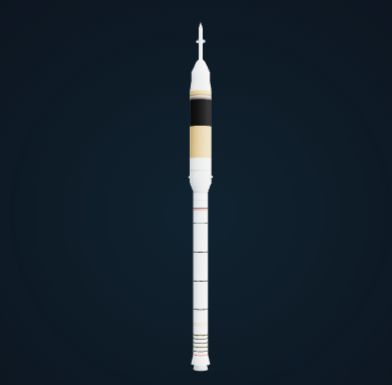
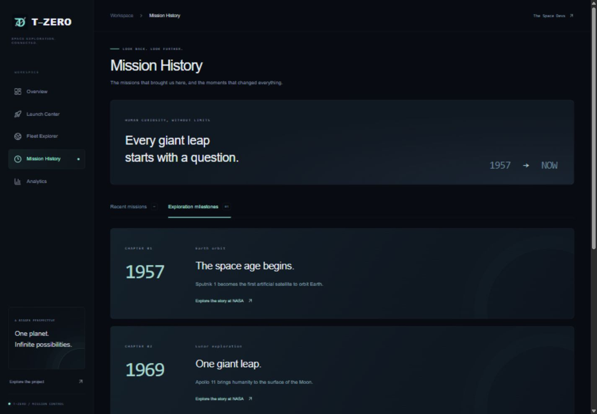

<p align="center">
  
</p>

<h1 align="center">T–ZERO</h1>
<p align="center"><strong>A bigger perspective on space exploration.</strong></p>
<p align="center">Explore upcoming launches, discover the machines behind them, and follow humanity beyond Earth.</p>

<p align="center">
  <a href="#a-look-inside">Screenshots</a> ·
  <a href="#features">Features</a> ·
  <a href="#run-locally">Run locally</a> ·
  <a href="#android">Android</a> ·
  <a href="public/models/ATTRIBUTION.md">Asset credits</a>
</p>

---

T-Zero is a space mission dashboard built around an interactive Earth, source-backed launch schedules, and a hands-on 3D heritage collection. A dark mission-control interface, mint accents, and restrained motion bring the experience together across desktop and mobile.

## A look inside

### Your orbital overview

An interactive Earth connects each mission to its launch site, with mission details, UTC/local time, bookmarks, and countdowns when the source provides sufficient time precision.



_Screenshots capture the app at a point in time. Mission schedules, counts, and countdowns will change as the source updates._

### Get closer to the machines

Rotate NASA-sourced models, focus on their upper and lower sections, and explore an educational Saturn V stage-separation diagram.



|                                          Friendship 7                                          |                                       Ares I                                        |
| :--------------------------------------------------------------------------------------------: | :---------------------------------------------------------------------------------: |
|  |  |
|                 NASA capsule geometry with reference-based restored finishes.                  |  NASA's colored historical concept model, with stray duplicate fragments removed.   |

### The moments that brought us here

Browse recent launches or revisit selected milestones, from the beginning of the space age to new views of the universe.



## Features

| Experience                 | What you can do                                                                                                                                   |
| -------------------------- | ------------------------------------------------------------------------------------------------------------------------------------------------- |
| **Orbital overview**       | Rotate Earth, locate a selected launch site, inspect a mission, switch UTC/local time, and save missions on your device.                          |
| **Launch Center**          | Search missions, filter providers and statuses, view saved missions, and switch between list and monthly calendar views. Filters live in the URL. |
| **Fleet Explorer**         | Browse vehicle photos and specifications, filter manufacturers, and compare two rockets using a specification table and common-scale height bars. |
| **NASA 3D collection**     | Explore Saturn V, the Friendship 7 capsule, and an Ares I concept with rotate, pause, zoom, reset, and component-focus controls.                  |
| **Mission History**        | Filter a recent-launch timeline and explore four curated, NASA-linked historical milestones.                                                      |
| **Analytics**              | Filter a recent sample by provider and date, inspect launch activity and outcomes, read accessible chart data, and export CSV.                    |
| **Mobile & accessibility** | Use responsive bottom navigation, keyboard-accessible controls, reduced-motion support, and static model previews when WebGL is unavailable.      |
| **Android**                | Use the native Kotlin/Compose app with on-device Filament 3D, cached data, local bookmarks, and direct HTTPS source access.                       |

### Data, with context

- Launch schedules and modern fleet specifications come from [The Space Devs](https://thespacedevs.com/llapi).
- Schedules can change. Month- or year-only estimates are not pinned to individual calendar days, and precise countdowns require minute or second precision.
- History and analytics use **up to 100 recent records**, not the complete historical archive. Coverage dates and the outcome denominator are displayed in the app.
- Shared normalized caching reduces repeated provider requests. Unavailable, empty, loading, and rate-limited states are explicit.
- Saved missions are stored in the current browser/device; no account is required.
- The 3D collection is a heritage collection. Friendship 7 depicts the capsule, and Ares I is labeled as a historical concept. Models and the staging diagram are visual references, not engineering simulations.

## Built with

**Web:** Next.js App Router · React · TypeScript · Tailwind CSS · Three.js · Framer Motion · Recharts · Lucide

**Android v1.1:** Kotlin · Jetpack Compose · Material 3 · Filament · Coroutines · Lifecycle

GLB models and the Draco decoder are served locally. WebGL scenes load on demand, cap rendering resolution, and skip rendering while hidden. Reduced-motion preferences disable automatic rotation.

## Run locally

Use Node.js **22.18 or newer** to match the built-in TypeScript test runner.

```bash
git clone https://github.com/AdithyaSM31/T-Zero-Space-Mission-Dashboard.git
cd T-Zero-Space-Mission-Dashboard
npm install
npm run dev
```

Open [localhost:3000](http://localhost:3000). The web app uses its own Next.js API routes by default, so no API URL is needed for ordinary local development. Network access to the launch provider is required for current schedules; the labeled design preview and bundled heritage assets remain available independently.

### Checks and production build

```bash
npm test
npx tsc --noEmit
npm run build
npm start
```

Tests cover outcome calculations, calendar date precision, preserved capsule geometry, distinct model materials, and Ares I scene cleanup.

## Android

**T-Zero v1.1 is now a native Kotlin + Jetpack Compose app.** The Android project uses native screens and Google's Filament renderer for Earth and spacecraft models. Its package is `com.tzero.app`, with the current source at version `1.1.3` (code `5`).

[Download the latest v1.1.3 Android APK](https://github.com/AdithyaSM31/T-Zero-Space-Mission-Dashboard/releases/tag/v1.1.3). This optimized, non-debuggable build includes a SHA-256 checksum and uses the same test signing key as the previous downloads. It requires Android 7.0 or newer. Updating an existing installation requires a matching signing key.

The native app connects directly to The Space Devs over HTTPS, caches launch data on-device, and bundles its fleet catalog and 3D assets. A deployed Next.js backend or JavaScript bundle is not required for the native app.

### Build the native APK

Install JDK **17**, Android SDK **API 36**, and configure the SDK path in `android/local.properties`. Open the `android/` folder in Android Studio, with JDK 17 selected for Gradle.

From the repository root:

```bash
npm run build:android
npm run build:android:preview
npm run check:android
```

The build wrapper copies the debug-signed development APK to `releases/android/T-Zero-v1.1.3-debug.apk` and writes a SHA-256 checksum. Use `build:android:preview` for the optimized, non-debuggable test build (`T-Zero-v1.1.3-preview.apk`), which retains the local test signing key. These wrappers run Gradle; building directly from Android Studio does not require Node.js.

Windows, directly with Gradle:

```powershell
cd android
.\gradlew.bat :app:assembleDebug :app:testDebugUnitTest
```

Run emulator/device UI tests with `npm run test:android:device`. Release builds require your own signing key; use the same key as the previous app for installable updates.

See the [native Android guide](android/README.md) for architecture, offline behavior, testing, release signing, and migration details. **Do not run `npx cap sync android` against the native project.** The original web-wrapper export remains only as historical tooling under `npm run export:legacy-android-web`.

## Brand & visual assets

The new T-Zero mark combines a **T**, an orbital **zero**, and a navigation star. The app, favicon, README, and Android assets share the same mint-and-ice identity.

- [Production logo](public/brand/tzero-logo.png) · [High-resolution master](public/brand/tzero-logo-master.png)
- [Brand notes and generation prompt](public/brand/README.md)
- [NASA models, Earth imagery, and decoder attribution](public/models/ATTRIBUTION.md)

Regenerate logo sizes and Android artwork from the checked-in master:

```bash
node scripts/generate-brand-assets.cjs
npx capacitor-assets generate --android --iconBackgroundColor '#080c12' --splashBackgroundColor '#080c12'
```

## Project map

```text
src/app/              Routes, shared layout, styles, and API endpoints
src/components/       Mission UI, charts, Earth, and model viewers
src/lib/              Data types, normalized source caching, and metrics
public/brand/         Logo master, app-size exports, and brand notes
public/models/        NASA heritage assets, previews, and attribution
public/draco/         Local model decoder and license
public/textures/      Earth surface texture
docs/images/          Current README screenshots
assets/               Android logo and splash sources
android/              Native Kotlin/Compose Android v1.1 project
scripts/              Android export, brand generation, and model repairs
tests/                Metrics and model regression tests
```

See [the implementation notes](DESIGN_PLAN.md) for design decisions and validation scope.

---

<p align="center"><strong>One planet. Infinite possibilities.</strong><br/>Built for the curious.</p>
